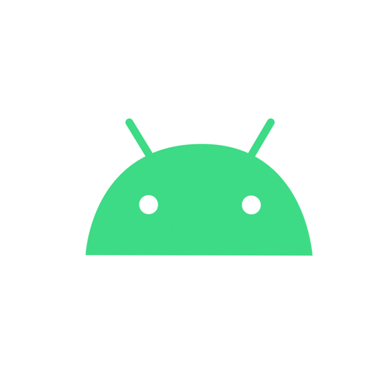

## `</alan-echer>` :rocket::rocket::brazil:
  

Atualmente atuo no desenvolvimento de software assistido por Inteligência Artificial, utilizando o agente Devin AI como parte do processo de engenharia para implementação de funcionalidades, análise de cenários técnicos, elaboração de Pull Requests e automação de tarefas de desenvolvimento. Minha atuação envolve revisar, validar e evoluir as entregas produzidas pelo agente, garantindo aderência à arquitetura, qualidade do código e padrões de engenharia antes da integração ao produto.

Sou Senior Android Engineer com mais de 13 anos de experiência no desenvolvimento de aplicações móveis e soluções corporativas, com atuação em empresas dos segmentos financeiro, ERP, transformação digital e startups. Atualmente desenvolvo produtos digitais para o Santander, através da GFT, participando da evolução da plataforma ODS (Open Development System), framework estratégico utilizado para padronização do desenvolvimento de aplicações globais.

Minha especialidade é o desenvolvimento Android utilizando Kotlin e Java, com experiência em arquitetura de software, revisão técnica de código, liderança técnica, gestão de releases, publicação de aplicativos e melhoria contínua de produtos utilizados por milhões de clientes.

Paralelamente, venho direcionando minha carreira para Inteligência Artificial, Machine Learning e Deep Learning, buscando aplicar essas tecnologias na engenharia de software e na automação do ciclo de desenvolvimento.

🎓 MBA em Data Science com IA — Instituto INFNET (em andamento)

🎓 MIT em Inteligência Artificial, Machine Learning e Deep Learning — Instituto INFNET

Certificações

 • AWS Certified AI Practitioner (AIF-C01)
 
 • AWS Certified Developer – Associate (DVA-C02)
 
 • AWS Certified Cloud Practitioner (CLF-C02)
 
 • Microsoft Azure Fundamentals (AZ-900)
 
Principais tecnologias

 Android • Kotlin • Java • ODS • Devin AI • Clean Architecture • Jetpack • Room • Retrofit • Dagger • Hilt • RxJava • Coroutines • Spring • Docker • AWS • PostgreSQL • Git • CI/CD
 
Perfis

 GitHub: github.com/echer
 
 GitLab: gitlab.com/alan.echer
 
 Google Developer Profile: developers.google.com/profile/u/115948025549606551601
 
 Kaggle: kaggle.com/alanecher

### :brain: Artificial Intelligence & Machine Learning

### :robot: Generative AI & AI Engineering

### :cloud: Cloud AI & MLOps

### :rocket: Mobile
 
 
 

 
 

### :computer: Web
 
 
 
 
 

 
 
 
 
 
 

### :zap: Others

 
 

 

 

### :zap: Database

### :memo: IDE's

### :zap: Version Control

### :zap: OS
 

 

### :zap: Cloud

### :zap: Server

### :student: Learning

### :zap: Agile & Testing

### :video_game::musical_note: Gaming & Music & Browser & Crypto

### :telephone_receiver: Contatos

### ⚡ Github Status

  
  

